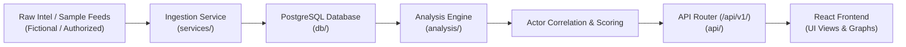

# DARKTRACE Architecture (Phase 1: Skeleton)

## System Overview

DARKTRACE is a threat-intelligence and actor-correlation platform developed as an academic cybersecurity project. The system is designed to correlate threat actor profiles, analyze stylistic similarities in cyber-crime communications, and provide researchers with structured intelligence.

Phase 1 focuses entirely on foundational infrastructure, operational health-checking, and cross-layer standards.

---

## Architectural Layers

The backend follows a modular, layered architecture to maintain high separation of concerns:

```
[ Frontend (React + Vite + Tailwind CSS) ]
                   │
                   ▼ (HTTP JSON REST /api/v1)
[ API Layer: backend/app/api/ ]
  - Request routing, input validation (Pydantic), envelope serialization
                   │
                   ▼
[ Services Layer: backend/app/services/ ]
  - Business orchestration, feed ingestion, ETL handling, entity lifecycle
                   │
                   ▼
[ Analysis Layer: backend/app/analysis/ ]
  - Correlation algorithms, stylometric comparison, graph analytics, heuristic scoring
                   │
                   ▼
[ Database Layer: backend/app/db/ ]
  - SQLAlchemy 2.0 ORM models, session lifecycle, connection pooling to PostgreSQL
```

### 1. API Layer (`app/api/`)
- Handles incoming HTTP requests and delivers uniform responses via the DARKTRACE envelope.
- Implements versioned routes under `/api/v1/`.
- Never executes direct raw business logic or SQL queries; instead, delegates to services or database session dependencies.

### 2. Services Layer (`app/services/`)
- Manages business workflows, scheduling, data transformation, and integration coordination.
- In later phases, this layer will orchestrate actor profile management, feed parsing, and search indexing.

### 3. Analysis Layer (`app/analysis/`)
- Hosts isolated computational and analytical modules (e.g., stylometric feature extraction, text token similarity, actor behavioral heuristics).
- Pure computational functions that accept domain data and output correlation metrics without direct HTTP coupling.

### 4. Database Layer (`app/db/`)
- Encapsulates database connectivity, session pooling, and migration schemas using SQLAlchemy 2.0 and PostgreSQL 16.

---

## Planned Data Flow (Future Phases)



---

## Ethical & Legal Boundaries (Mandatory Research Principles)

DARKTRACE adheres strictly to ethical research standards for academic cybersecurity:

1. **Authorized & Synthetic Data Only**:
   - The platform strictly consumes simulated, synthetic, or explicitly authorized benchmark datasets.
   - **NO live scraping, darknet crawling, automated scanning, or intrusion testing** of third-party systems is permitted or implemented.

2. **No Attribution to Real-World Persons**:
   - Similarity scores, graph correlations, and stylometric matches are mathematical heuristics evaluated on controlled datasets.
   - The system **never asserts or claims definitive real-world legal identity** based on correlation algorithms.

3. **Defensive Research & Education**:
   - All modules are developed exclusively for educational threat research, defensive posture improvement, and academic evaluation.

