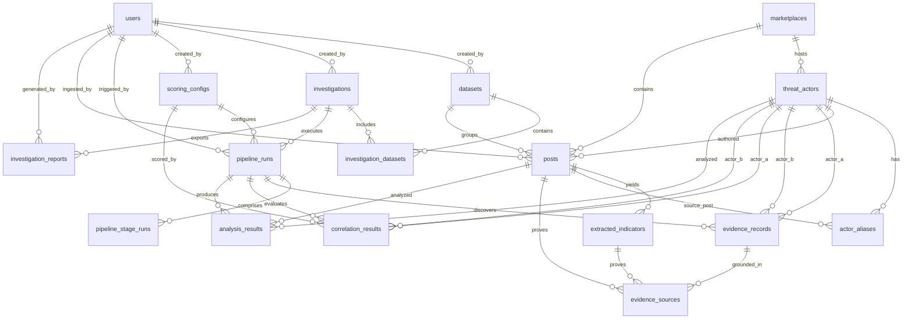

# DARKTRACE Database Schema & Data Modeling (Phase 2)

## Architectural Purpose

The DARKTRACE data model supports academic cybersecurity research on threat actor correlation and stylometric footprinting across illicit dark web platforms. The schema enforces immutability for ingested raw intelligence, strict relational integrity for forensic traceability, and database-level constraints to prevent logically contradictory correlation graphs.

> **CRITICAL ETHICS & FORENSIC ATTRIBUTION RULE:**  
> **Correlation scores are heuristic evidence scores, not verified identity probabilities.**  
> The system operates solely on authorized and synthetic benchmark datasets. High mathematical correlation between distinct aliases does not constitute legal or factual proof of a single real-world identity.

---

## Entity-Relationship Diagram

---

## Table-by-Table Reference

### 1. `users`
System accounts for investigators and administrative users.
- `id` (INTEGER IDENTITY PK): Unique user identifier.
- `email` (VARCHAR(255) UNIQUE): Account contact email address.
- `username` (VARCHAR(100) UNIQUE): System login handle.
- `password_hash` (VARCHAR(255)): Secure password hash digest.
- `full_name` (VARCHAR(255)): Investigator's display name.
- `role` (user_role ENUM: `'admin'`, `'investigator'`): Role-based access control tier.
- `is_active` (BOOLEAN DEFAULT TRUE): Account active status flag.
- `last_login_at` (TIMESTAMPTZ NULL): Timestamp of latest system login.
- `created_at` / `updated_at` (TIMESTAMPTZ): Standard audit timestamps.

### 2. `datasets`
Curated collections of dark web communications, listings, or forum dumps.
- `id` (INTEGER IDENTITY PK): Unique dataset identifier.
- `name` (VARCHAR(255) UNIQUE): Unique human-readable dataset title.
- `description` (TEXT NULL): Detailed dataset scope and provenance.
- `source_type` (dataset_source_type ENUM: `'sample'`, `'manual'`, `'csv'`, `'json'`): Provenance mechanism.
- `is_fictional` (BOOLEAN DEFAULT TRUE): Mandatory indicator that data is synthetic/authorized.
- `created_by` (INTEGER FK users.id NULL): Investigator who created the dataset.
- `created_at` / `updated_at` (TIMESTAMPTZ): Standard audit timestamps.

### 3. `investigations`
Forensic case files organizing target datasets and analysis pipelines.
- `id` (INTEGER IDENTITY PK): Unique investigation case number.
- `title` (VARCHAR(255)): Case or dossier title.
- `description` (TEXT NULL): Investigative hypothesis or scope notes.
- `status` (investigation_status ENUM: `'draft'`, `'processing'`, `'completed'`, `'failed'`): Case progression status.
- `created_by` (INTEGER FK users.id RESTRICT): Lead investigator responsible for case. Deleting user while case exists is rejected.
- `created_at` / `updated_at` (TIMESTAMPTZ): Standard audit timestamps.

### 4. `investigation_datasets`
Association join table mapping investigations to their constituent datasets.
- `investigation_id` (INTEGER FK investigations.id CASCADE): Parent investigation.
- `dataset_id` (INTEGER FK datasets.id CASCADE): Associated dataset.
- `added_at` (TIMESTAMPTZ): Timestamp dataset was included in the case.
- **Primary Key:** `(investigation_id, dataset_id)` composite.

### 5. `marketplaces`
Darknet forums, illicit marketplaces, or paste platforms.
- `id` (INTEGER IDENTITY PK): Unique platform identifier.
- `name` (VARCHAR(255) UNIQUE): Canonical platform name (e.g., "Velvet Bazaar").
- `description` (TEXT NULL): Platform characteristics, software stack, or timeline notes.
- `is_fictional` (BOOLEAN DEFAULT TRUE): Safety classification flag.
- `created_at` / `updated_at` (TIMESTAMPTZ): Standard audit timestamps.
- **Unique Indexes:** `uq_marketplaces_lower_name` on `LOWER(name)` ensures platform names are strictly unique case-insensitively.

### 6. `threat_actors`
Observed digital identity handles active on monitored platforms.
- `id` (INTEGER IDENTITY PK): Unique threat actor record.
- `marketplace_id` (INTEGER FK marketplaces.id RESTRICT): Platform where identity handle operates.
- `username` (VARCHAR(255)): Original verbatim handle as observed in postings.
- `normalised_username` (VARCHAR(255)): Lower-cased, whitespace-trimmed canonical representation.
- `first_seen_at` (TIMESTAMPTZ NULL): Earliest observed activity timestamp.
- `last_seen_at` (TIMESTAMPTZ NULL): Latest observed activity timestamp.
- `created_at` / `updated_at` (TIMESTAMPTZ): Standard audit timestamps.
- **Unique Constraint:** `(marketplace_id, normalised_username)` ensures no duplicate handles per platform.

### 7. `actor_aliases`
Secondary monikers, handles, or jabber/contact aliases linked to an actor.
- `id` (INTEGER IDENTITY PK): Unique alias record.
- `actor_id` (INTEGER FK threat_actors.id CASCADE): Primary threat actor record.
- `alias` (VARCHAR(255)): Verbatim observed alias.
- `normalised_alias` (VARCHAR(255)): Canonical trimmed/lowercase alias.
- `source_post_id` (INTEGER FK posts.id SET NULL): Post where the alias was declared or observed.
- `created_at` (TIMESTAMPTZ): Observation timestamp.
- **Unique Constraint:** `(actor_id, normalised_alias)`.

### 8. `posts`
Raw forum posts, market listings, or message communications.
- `id` (INTEGER IDENTITY PK): Unique post record.
- `dataset_id` (INTEGER FK datasets.id CASCADE): Ingested dataset container.
- `marketplace_id` (INTEGER FK marketplaces.id RESTRICT): Origin platform.
- `actor_id` (INTEGER FK threat_actors.id RESTRICT NULL): Linked threat actor author.
- `author_username` (VARCHAR(255)): Original author string supplied with post.
- `content` (TEXT): Immutable text body (never modified post-insertion).
- `dedupe_hash` (CHAR(64)): SHA-256 fingerprint enforcing ingest idempotency.
- `posted_at` (TIMESTAMPTZ NULL): Timestamp reported on platform.
- `source_reference` (VARCHAR(512) NULL): Original external URL or dump offset.
- `raw_metadata` (JSONB): Unstructured vendor, category, or header fields.
- `extractor_version` (VARCHAR(20) NULL): Version string of the extraction engine (e.g. `'1.0.0'`).
- `extracted_at` (TIMESTAMPTZ NULL): UTC timestamp when indicator extraction was executed on this post.
- `ingested_by` (INTEGER FK users.id SET NULL): Analyst who triggered ingestion.
- `created_at` (TIMESTAMPTZ): System ingestion timestamp.
- **Unique Constraint:** `(dataset_id, dedupe_hash)` prevents duplicate records within a dataset.
- **Indexes:** `actor_id`, `marketplace_id`, `posted_at`.

### 9. `extracted_indicators`
Atomic technical artifacts parsed from post content (cryptographic wallets, onion domains, fingerprints).
- `id` (INTEGER IDENTITY PK): Unique indicator record.
- `post_id` (INTEGER FK posts.id CASCADE): Ground-truth post container.
- `indicator_type` (indicator_type ENUM: `'pgp_fingerprint'`, `'wallet_btc'`, `'wallet_eth'`, `'wallet_xmr'`, `'wallet_other'`, `'domain'`, `'ip_address'`, `'ssl_cert_fingerprint'`, `'cert_metadata'`, `'server_banner'`, `'port'`).
- `raw_value` (TEXT): Exact token substring as extracted.
- `normalised_value` (TEXT): Normalized canonical representation (e.g. lowercase address, trimmed domain).
- `span_start` / `span_end` (INTEGER NULL): Character offsets within `posts.content`.
- `extraction_method` (extraction_method ENUM: `'regex'`, `'structured_field'`, `'manual'`).
- `extractor_version` (VARCHAR(50)): Version stamp of extraction algorithm.
- `is_valid_format` (BOOLEAN): Checksum / RFC validation flag.
- `confidence` (VARCHAR(10) NOT NULL default 'high'): Qualitative confidence rating (`'high'`, `'medium'`, `'low'`).
- `details` (JSONB NOT NULL default '{}'): Forensic metadata (IP scope, SSL algorithm, port protocol, occurrences, all_spans, also_in_structured_field).
- `created_at` (TIMESTAMPTZ): Extraction timestamp.
- **Unique Constraint:** `(post_id, indicator_type, normalised_value)`.
- **Index:** `(indicator_type, normalised_value)` for high-speed cross-actor indicator lookups.
- **Check Constraint:** `(span_start IS NULL OR span_end IS NULL) OR (span_end >= span_start)`.
- **Check Constraint:** `confidence IN ('high', 'medium', 'low')`.

### 10. `scoring_configs`
Mathematical parameter profiles governing correlation weights and thresholds.
- `id` (INTEGER IDENTITY PK): Unique configuration profile.
- `name` (VARCHAR(255)): Profile label (e.g., "Default_Heuristic_V1").
- `version` (INTEGER): Integer version sequence.
- `weights` (JSONB): Dimension weights (e.g. `{"cryptographic": 0.4, "infrastructure": 0.3, "stylometric": 0.3}`).
- `thresholds` (JSONB): Cutoffs (e.g. `{"min_similarity": 0.65}`).
- `is_active` (BOOLEAN): Flag denoting the active system default scoring engine.
- `created_by` (INTEGER FK users.id SET NULL): Configuration author.
- `created_at` / `updated_at` (TIMESTAMPTZ): Standard audit timestamps.
- **Unique Constraint:** `(name, version)`.
- **Partial Unique Index:** `uq_scoring_configs_is_active` where `is_active = true` (ensures at most one active profile).

### 11. `pipeline_runs`
Execution run instances tracking multi-stage forensic analysis passes.
- `id` (INTEGER IDENTITY PK): Unique run identifier.
- `investigation_id` (INTEGER FK investigations.id CASCADE): Target case file.
- `scoring_config_id` (INTEGER FK scoring_configs.id SET NULL): Parameters used.
- `status` (pipeline_run_status ENUM: `'queued'`, `'running'`, `'completed'`, `'failed'`).
- `triggered_by` (INTEGER FK users.id SET NULL): Operating analyst.
- `started_at` / `finished_at` (TIMESTAMPTZ NULL): Execution timestamps.
- `error_message` (TEXT NULL): Failure diagnostics.
- `created_at` (TIMESTAMPTZ): Dispatch timestamp.
- **Partial Unique Index:** `uq_pipeline_runs_active_investigation` on `(investigation_id) WHERE status IN ('queued', 'running')` guarantees at most one active pipeline execution per investigation at any time.

### 12. `pipeline_stage_runs`
Progress and metrics tracking for individual analytical modules.
- `id` (INTEGER IDENTITY PK): Unique stage run record.
- `pipeline_run_id` (INTEGER FK pipeline_runs.id CASCADE): Parent pipeline execution.
- `stage` (pipeline_stage ENUM: `'crypto_matching'`, `'infrastructure_matching'`, `'behavioural_analysis'`, `'stylometric_analysis'`, `'scoring'`).
- `status` (pipeline_stage_status ENUM: `'pending'`, `'running'`, `'completed'`, `'failed'`, `'skipped'`).
- `started_at` / `finished_at` (TIMESTAMPTZ NULL): Stage execution window.
- `items_processed` (INTEGER DEFAULT 0): Stage throughput count.
- `summary` (JSONB): Stage performance metrics and entity tallies.
- `error_message` (TEXT NULL): Stage-specific failure details.
- **Unique Constraint:** `(pipeline_run_id, stage)` guarantees one execution per stage per pipeline run.

### 13. `evidence_records`
Atomic pairwise analytical observations connecting or distinguishing two threat actors.
- `id` (INTEGER IDENTITY PK): Unique evidence item.
- `pipeline_run_id` (INTEGER FK pipeline_runs.id CASCADE): Run that produced this evidence.
- `actor_a_id` (INTEGER FK threat_actors.id RESTRICT): First actor.
- `actor_b_id` (INTEGER FK threat_actors.id RESTRICT): Second actor.
- `dimension` (evidence_dimension ENUM: `'cryptographic'`, `'behavioural'`, `'stylometric'`, `'infrastructure'`).
- `evidence_type` (VARCHAR(100)): Analytical pattern (e.g. `shared_monero_subaddress`, `stylometric_cosine`).
- `direction` (evidence_direction ENUM: `'supporting'`, `'contradicting'`).
- `strength` (NUMERIC(5, 4)): Confidence weighting between `0.0000` and `1.0000`.
- `explanation` (TEXT): Natural-language forensic justification.
- `details` (JSONB): Mathematical parameters (p-values, token overlaps, feature diffs).
- `created_at` (TIMESTAMPTZ): Generation timestamp.
- **Check Constraint:** `actor_a_id < actor_b_id` enforces strict canonical ordering and prevents reflexive or inverted duplicate pairs.
- **Check Constraint:** `strength >= 0 AND strength <= 1` bounds score validity.
- **Indexes:** `(pipeline_run_id, actor_a_id, actor_b_id)` and `(pipeline_run_id, dimension)`.

### 14. `evidence_sources`
Full forensic provenance linking an abstract evidence record back to its source post or indicator.
- `id` (INTEGER IDENTITY PK): Unique traceability record.
- `evidence_id` (INTEGER FK evidence_records.id CASCADE): Target evidence claim.
- `post_id` (INTEGER FK posts.id SET NULL NULL): Source post ground truth.
- `indicator_id` (INTEGER FK extracted_indicators.id SET NULL NULL): Source indicator ground truth.
- **Check Constraint:** `post_id IS NOT NULL OR indicator_id IS NOT NULL` guarantees every evidence source points to at least one concrete piece of evidence.
- **Index:** `ix_evidence_sources_evidence_id` on `(evidence_id)`.

### 15. `correlation_results`
Consolidated affinity metric evaluated across all available evidence dimensions for an actor pair.
- `id` (INTEGER IDENTITY PK): Unique correlation score record.
- `pipeline_run_id` (INTEGER FK pipeline_runs.id CASCADE): Evaluating pipeline run.
- `actor_a_id` (INTEGER FK threat_actors.id RESTRICT): First actor.
- `actor_b_id` (INTEGER FK threat_actors.id RESTRICT): Second actor.
- `combined_score` (NUMERIC(5, 4)): Overall affinity metric (0.0000 to 1.0000). Column Comment: *"Heuristic evidence score. NOT a verified probability of common identity."*
- `dimension_scores` (JSONB): Breakdown by dimension (e.g. `{"cryptographic": 0.85, "stylometric": 0.62}`).
- `contributions` (JSONB): Normalized feature contribution percentages.
- `missing_dimensions` (JSONB DEFAULT '[]'): Dimensions where insufficient data existed.
- `contradictions` (JSONB DEFAULT '[]'): Explicit contradictory indicators observed.
- `scoring_config_id` (INTEGER FK scoring_configs.id RESTRICT): Scoring weights used.
- `created_at` (TIMESTAMPTZ): Evaluation timestamp.
- **Unique Constraint:** `(pipeline_run_id, actor_a_id, actor_b_id)`.
- **Check Constraint:** `actor_a_id < actor_b_id`.
- **Check Constraint:** `combined_score >= 0 AND combined_score <= 1`.

### 16. `analysis_results`
Dense mathematical vectors, TF-IDF summaries, or behavioral histograms per actor/post.
- `id` (INTEGER IDENTITY PK): Unique analysis artifact.
- `pipeline_run_id` (INTEGER FK pipeline_runs.id CASCADE): Generating pipeline run.
- `actor_id` (INTEGER FK threat_actors.id SET NULL NULL): Target actor (if actor-level analysis).
- `post_id` (INTEGER FK posts.id SET NULL NULL): Target post (if post-level analysis).
- `analysis_type` (analysis_type ENUM: `'stylometry_features'`, `'behaviour_profile'`, `'tfidf_summary'`, `'other'`).
- `result` (JSONB): Dense feature dictionaries or array embeddings.
- `created_at` (TIMESTAMPTZ): Generation timestamp.

### 17. `investigation_reports`
Exported forensic dossiers and summary packages for investigation handoffs.
- `id` (INTEGER IDENTITY PK): Unique report archive record.
- `investigation_id` (INTEGER FK investigations.id CASCADE): Source investigation.
- `format` (report_format ENUM: `'pdf'`, `'csv'`, `'json'`).
- `file_path` (VARCHAR(512)): On-disk artifact storage path.
- `generated_by` (INTEGER FK users.id SET NULL): Requesting analyst.
- `parameters` (JSONB): Export filtering and scoring thresholds applied.
- `created_at` (TIMESTAMPTZ): Generation timestamp.

---

## Forensic Integrity & Deduplication Rules

1. **Post Deduplication (`dedupe_hash`):**
   - Each post computes a 64-character SHA-256 digest:
     $$\text{dedupe\_hash} = \text{SHA256}(\text{marketplace\_id} \parallel \text{normalised\_username} \parallel \text{posted\_at\_iso} \parallel \text{content\_normalized})$$
   - Combined with `UNIQUE(dataset_id, dedupe_hash)`, this guarantees re-ingesting a raw dump never generates duplicated posts within an investigation dataset.

2. **Forensic Traceability:**
   - Every entry in `evidence_records` must have at least one corresponding record in `evidence_sources`.
   - The check constraint `post_id IS NOT NULL OR indicator_id IS NOT NULL` guarantees that no heuristic claim can exist without pointing directly back to an immutable raw post or verified extracted indicator.

3. **Canonical Actor Ordering:**
   - In both `evidence_records` and `correlation_results`, `actor_a_id < actor_b_id` is enforced by database check constraints. This prevents duplicate asymmetric comparisons (e.g., scoring Actor 1 vs Actor 2, and then Actor 2 vs Actor 1 separately).

